# Fokker F28 Mk 4000 — Structural Loads and Preliminary Wing-Box Sizing

This repository contains selected MATLAB scripts and figures from a larger university project on the Fokker F28 Mk 4000. I developed the study during my Aerospace Engineering coursework at the Faculty of Aerospace Engineering, National University of Science and Technology POLITEHNICA Bucharest.

The work brings together aircraft mass and balance, aerodynamic estimates, flight and landing loads, spanwise wing loads, preliminary structural sizing, and elastic stability. The MATLAB files published here cover **selected calculations and visualizations**, rather than the entire analysis. The full coursework also includes handwritten and document-based derivations, sizing calculations, and stability assessments.

## Reference aircraft and calculation conditions

The following values are the reference data and estimates adopted in the university study. They should not be read as an independently verified manufacturer specification or a certification data set.

| Parameter | Value | Unit |
| :--- | ---: | :--- |
| Aircraft | Fokker F28 Fellowship Mk 4000 | — |
| Maximum takeoff mass | 33,110 | kg |
| Estimated empty-aircraft weight | 17,611 | daN |
| Estimated empty-aircraft CG station | 15.33 | m |
| Aircraft length / height | 29.61 / 8.47 | m |
| Wing span / semi-span | 25.07 / approximately 12.54 | m |
| Reference wing area | 79.00 | m² |
| Wing aspect ratio / quarter-chord sweep | 7.95 / 16 | — / deg |
| Mean geometric / aerodynamic chord | 3.15 / 3.48 | m |
| Horizontal tailplane area / span | 19.30 / 8.64 | m² / m |
| Vertical tailplane area | 12.30 | m² |
| Engines | 2 × Rolls-Royce Spey Mk 555-15H | — |
| Reference cruise Mach number | 0.74 | — |
| Structural calculation cruise speed at 1,500 m | 224.00 | m/s |
| Reference stall / maneuvering / dive speeds | 73.95 / 116.92 / 280.00 | m/s |
| Coursework limit maneuver load factors | +2.50 / −1.00 | — |

Some scripts use their own parameters for specific coursework exercises. The figures and numerical examples below are therefore identified by the calculation to which they belong.

## MATLAB files

Each script can be opened and run separately from the repository root in MATLAB.

| File | Purpose |
| :--- | :--- |
| **naca_0014_40Ymod.m** | Simplified 14%-thick symmetric wing-root profile with maximum thickness near 40% chord |
| **NACA_64A012.m** | Approximate symmetric 12%-thick horizontal-tailplane profile for visualization; not a reconstruction from tabulated NACA 64A012 coordinates |
| **naca_0015_40Ymod.m** | Simplified 15%-thick symmetric vertical-tailplane profile |
| **DISTRIBUTIA_FACTORULUI_DE_SARCINA_LOCAL.m** | Longitudinal load-factor distribution for prescribed elevator deflections |
| **MANEVRA_CONTROLATA_DE_PROFUNDOR.m** | Longitudinal load-factor distribution during a checked pitch maneuver |
| **DISTRIBUTIA_FACTORULUI_DE_SARCINA_LATERAL_n_y.m** | Lateral load-factor distribution for prescribed rudder deflections |
| **REPARTITIA_SARCINILOR_AERODINAMICE_SI_MASICE.m** | Illustrative distributed lift, structural-weight, and fuel-weight terms along the wing |
| **generarea_diagramei_fortei_taietoare_Tzy.m** | Piecewise analytical shear-force distribution |
| **generarea_diagramei_momentului_incovoietor_Mxy.m** | Piecewise analytical bending-moment distribution |
| **generarea_diagramei_momentului_de_torsiune_repartizat_mty.m** | Distributed torsional moment used in the coursework model |
| **diagrama_momentului_de_torsiune_Mty.m** | Piecewise analytical torsion-moment distribution |
| **figures/** | Eleven plots, including updated load and torsion diagrams |
| **README.md** | Overview of the study and selected results |

## 1. Mass estimates and aerodynamic reference calculations

### Estimated empty-aircraft mass distribution

The coursework uses empirical component estimates to determine the empty-aircraft CG. The reported total is **17,611 daN**, with a longitudinal CG station of **15.33 m**.

| Component | Estimated weight [daN] | Station [m] | Weight × station [daN·m] |
| :--- | ---: | ---: | ---: |
| Wing | 2,396 | 14.50 | 34,742 |
| Fuselage | 7,397 | 14.00 | 103,558 |
| Horizontal tailplane | 234 | 28.50 | 6,669 |
| Vertical tailplane | 334 | 27.00 | 9,018 |
| Propulsion system | 2,990 | 23.00 | 68,770 |
| Main landing gear | 1,159 | 15.50 | 17,964 |
| Nose landing gear | 265 | 3.50 | 927 |
| Equipment | 2,836 | 10.00 | 28,360 |
| **Total** | **17,611** | **CG = 15.33** | **270,008** |

These values come from the analytical coursework; the repository does not contain a separate MATLAB mass-estimation model.

### Airfoil geometry and lift-curve estimates

The reference study considers modified symmetric profiles at the wing and vertical tailplane, together with a NACA 64A012 reference for the horizontal tailplane. The MATLAB plots use simplified thickness distributions for geometry illustration, so they should not be treated as exact digitizations of these airfoils.

The associated coursework also applies approximate subsonic compressibility corrections. The resulting lift-curve slopes reported in the study are:

$$
C_{L_\alpha,\mathrm{wing}}=5.71\ \mathrm{rad}^{-1},\qquad
C_{L_\alpha,\mathrm{HTP}}=4.12\ \mathrm{rad}^{-1},\qquad
C_{L_\alpha,\mathrm{VTP}}=3.67\ \mathrm{rad}^{-1}.
$$

  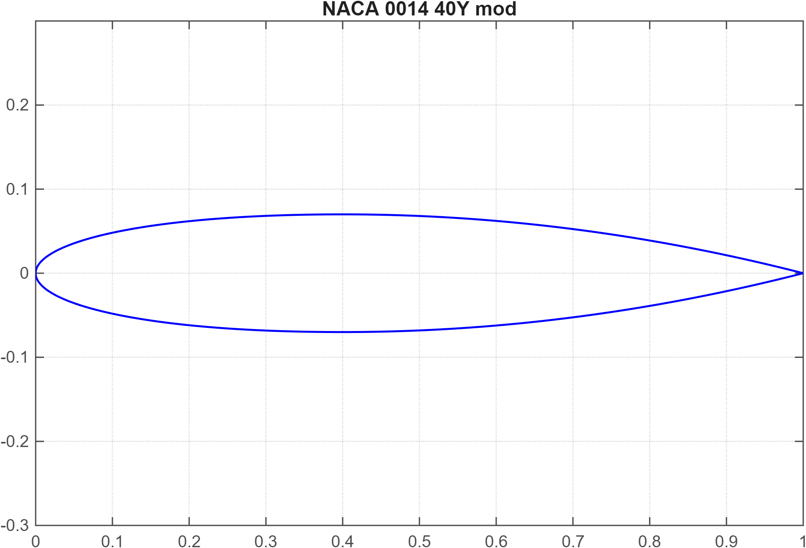
  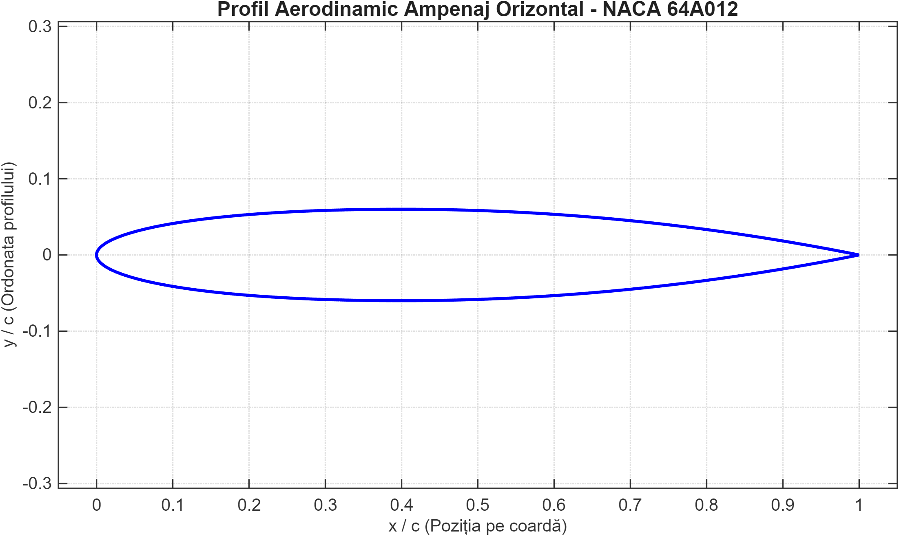
  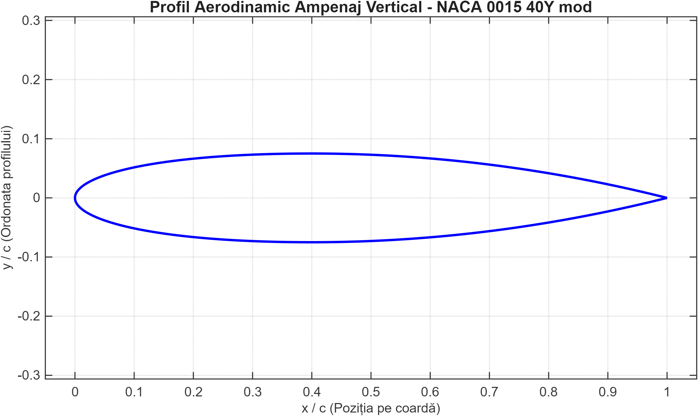

## 2. Maneuver and landing load cases

The aircraft study includes a maneuver and gust-load assessment as well as prescribed elevator and rudder inputs. Selected reference gust-load factors from the coursework are:

| Reference speed | Gust velocity | Calculated load-factor range |
| :--- | ---: | :--- |
| 116.92 m/s | 20 m/s | 0.55 to 1.45 |
| Cruise: 224.00 m/s | 15 m/s | −0.55 to 2.55 |
| Dive: 280.00 m/s | 7.5 m/s | 0.65 to 1.35 |

For the prescribed elevator case, the local longitudinal load factor is evaluated as

$$
n^\pm(x')=1+\frac{\Delta P_{\mathrm{HTP}}^\pm}{G}
\left(1+\frac{L_{\mathrm{HTP}}(x'-x_{\mathrm{CG}})}{r_y^2}\right).
$$

The coursework uses elevator deflections of +25° and −20° at 116.92 m/s, giving incremental horizontal-tailplane loads of approximately **+84.06 kN** and **−67.26 kN**. A separate checked-maneuver exercise evaluates the longitudinal distribution using a prescribed pitch acceleration of **0.4276 rad/s²**.

Rudder and landing-load cases are also included in the written study. The published MATLAB scripts visualize selected maneuver-load distributions rather than reproducing every landing-load calculation.

  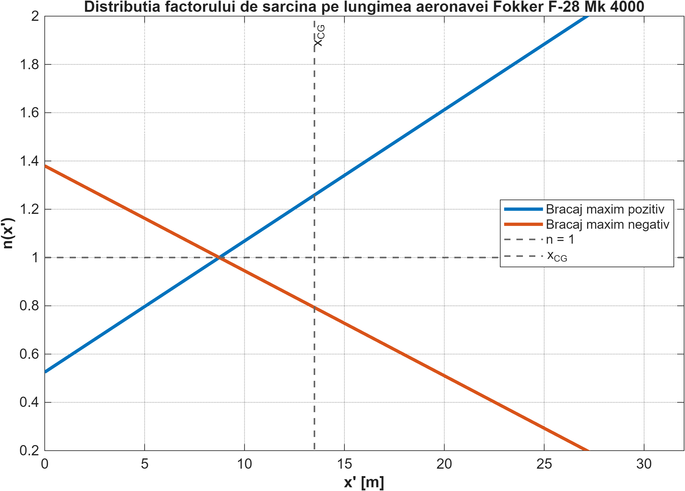
  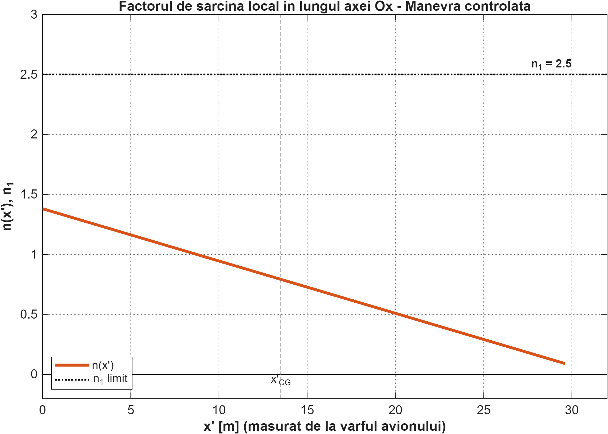
  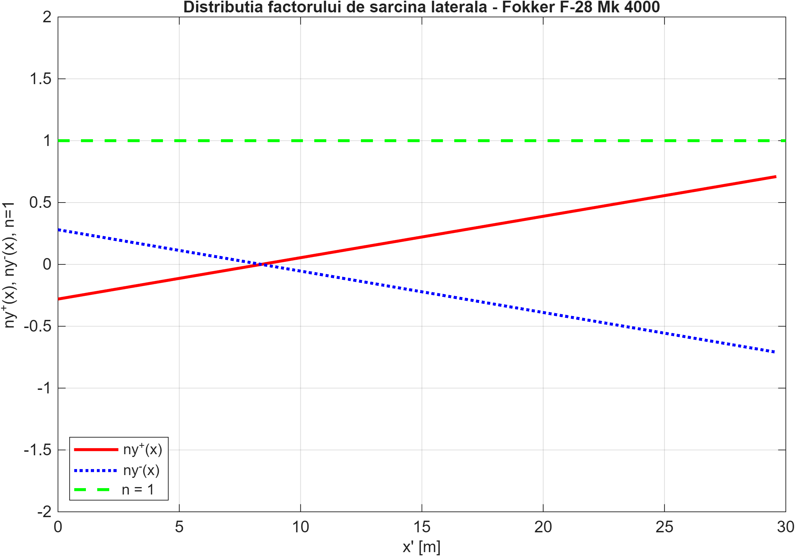

## 3. Spanwise wing loads and internal efforts

The wing-load illustration uses a Diederich-type approximation with coursework coefficients $C_1=0.50$, $C_2=0.16$, and $C_3=0.38$. With the simplified shape functions used in the MATLAB script, the raw distribution integrates to approximately **1.0331**. The script therefore normalizes it before applying the prescribed total lift of **827.65 kN**. See [Diederich, NACA TN 2751 (1952)](https://ntrs.nasa.gov/citations/19930083506) for the original method.

$$
\begin{aligned}
\widetilde L_a(\eta)&=C_1\frac{c(\eta)}{\overline c_g}
+C_2\frac{4}{\pi}\sqrt{1-\eta^2}+C_3f(\eta),\\
L_a(\eta)&=\frac{\widetilde L_a(\eta)}
{\int_0^1\widetilde L_a(u)\,du},\\
p_a(y)&=\frac{P_a}{2b}L_a(y/b).
\end{aligned}
$$

The wing is divided into intervals at **1.65 m**, **3.20 m**, and **8.50 m** along the semi-span to evaluate the analytical expressions for shear force, bending moment, and torsion, including the prescribed changes at the concentrated-load station.

The distributed-load illustration and the piecewise internal-effort scripts use simplified coursework representations rather than one shared parameterized load solver. In particular, the concentrated-load terms in the wing study are modeling assumptions; the F28's engines are mounted on the rear fuselage, not on the wing.

  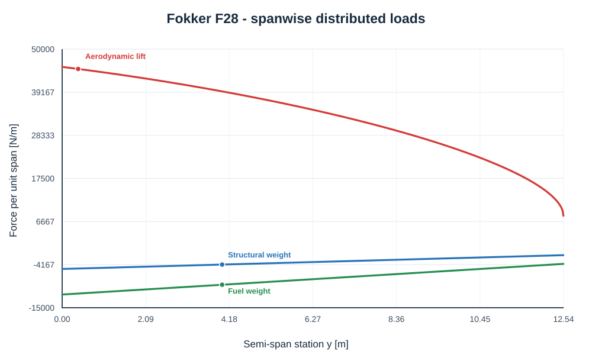

### Selected values from the internal-effort diagrams

Shear and bending results are retained from the original coursework. The torsion values are recomputed from the stated distributed loads, with continuous conditions at 8.50 m and 1.65 m and a 9.01 kNm point couple at 3.20 m.

| Semi-span station [m] | Shear [kN] | Bending moment [kNm] | Torsion moment [kNm] |
| :--- | ---: | ---: | ---: |
| 12.54 — tip | 0.00 | 0.00 | 0.00 |
| 8.50 | 92.48 | 161.51 | 18.89 |
| 3.20 — outboard side | 243.07 | 1,033.39 | 76.65 |
| 3.20 — inboard side | 173.60 | 1,033.39 | 85.67 |
| 1.65 — wing/fuselage junction | 223.02 | 1,340.61 | 106.12 |
| 0.00 — aircraft centerline in the idealized model | 286.97 | 1,761.29 | 126.25 |

  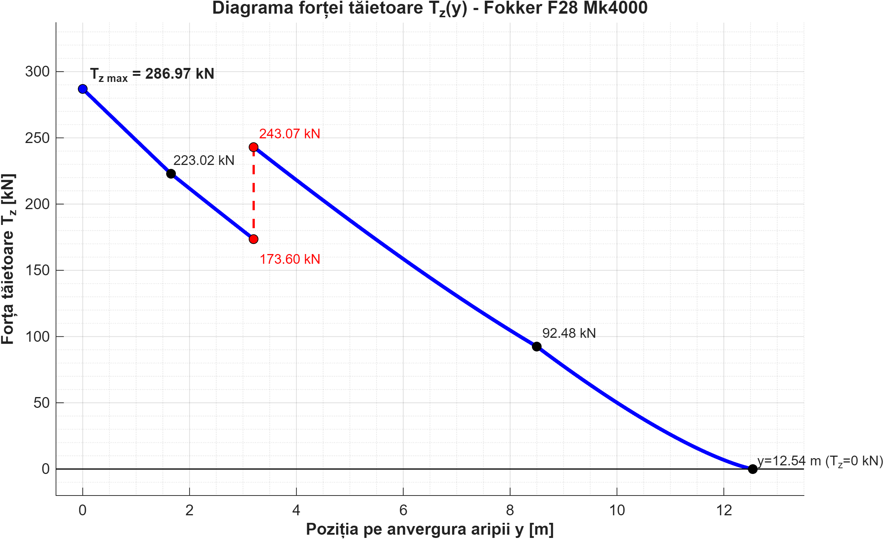
  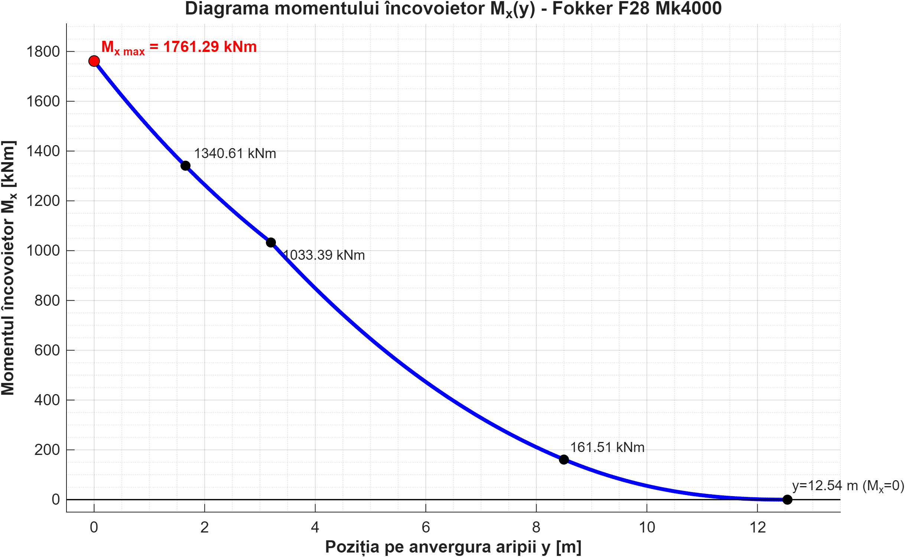

  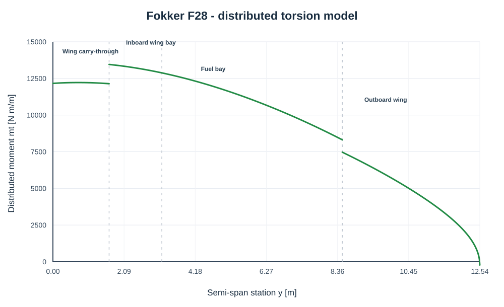
  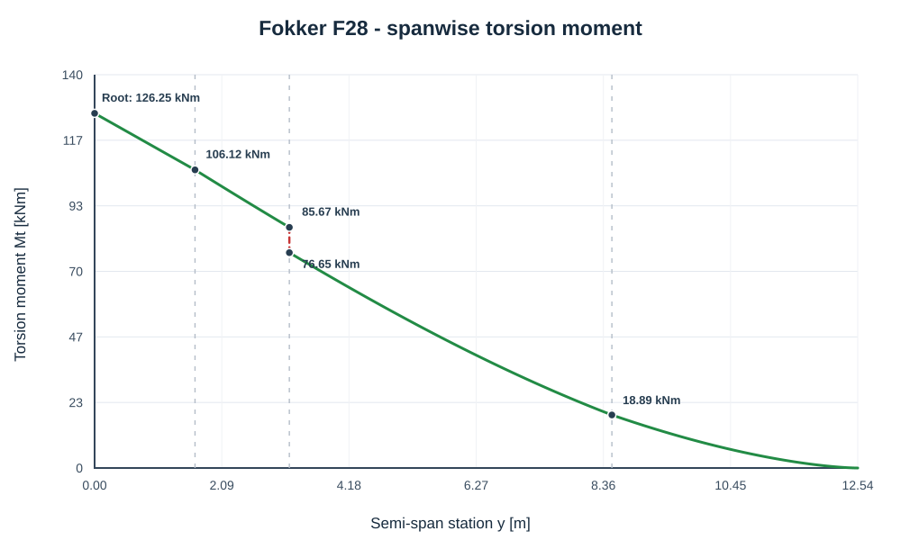

## 4. Preliminary wing-box sizing and elastic stability

The written project extends beyond the MATLAB plots to a preliminary two-spar wing-box study using Al 2024-T3 properties, spar flange and web sizing, a stiffened skin panel, and classical elastic buckling calculations. The assumed box boundaries are at approximately **15%** and **65%** of the local chord.

Representative sizing results from the coursework include:

| Item | Reported result |
| :--- | ---: |
| Front spar, tension flange area | 4,408.55 mm² |
| Front spar, compression flange area | 10,263.28 mm² |
| Rear spar, tension flange area | 3,879.52 mm² |
| Rear spar, compression flange area | 9,031.69 mm² |
| Front / rear spar web thickness | 2.54 / 2.19 mm |
| Adopted stiffened upper-skin thickness | 11.0 mm |
| Reference upper-skin panel pitch / rib spacing | 450 / 900 mm |

For plate stability, the study uses the classical elastic stress expressions

$$
\sigma_{\mathrm{cr}}=
\frac{k_\sigma\pi^2E}{12(1-\nu^2)}
\left(\frac{t}{b}\right)^2,\qquad
\tau_{\mathrm{cr}}=
\frac{k_\tau\pi^2E}{12(1-\nu^2)}
\left(\frac{t}{b}\right)^2.
$$

The resulting coursework comparisons are:

| Check | Assumed coefficient | Critical stress [MPa] | Applied stress [MPa] |
| :--- | ---: | ---: | ---: |
| Compression, simply supported | 4.00 | 157.70 | 24.20 |
| Compression, clamped loaded edges | 7.00 | 275.97 | 24.20 |
| Shear, simply supported | 6.35 | 250.34 | 4.40 |
| Shear, clamped spar flanges | 9.98 | 393.45 | 4.40 |

These are analytical estimates for the assumed geometry, loads, material properties, and boundary conditions. They are not finite-element results or an aircraft-level structural substantiation.

**Sizing comparison.** Preliminary sizing in the original coursework uses a reference limit torque of **124.30 kNm** (186.44 kNm ultimate). Integration of the stated distributed load model gives **126.25 kNm** at the inboard station, a difference of about **1.6%**. The original flange and web sizes have not been recalculated for this updated input.

## Running the scripts

Clone or download the repository, open its root folder in MATLAB, and run any of the eleven scripts individually. Each script produces the relevant figure or set of figures; not every script automatically exports a PNG.

Some original figures retain their Romanian labels from coursework at POLITEHNICA Bucharest. The updated load and torsion charts are in English. The main quantities are explained here: *forța tăietoare* means shear force, *moment încovoietor* means bending moment, *moment de torsiune* means torsion moment, and *sarcini aerodinamice și masice* means aerodynamic and mass-related loads.

## Academic context

I developed this work across three courses in the Aerospace Structures specialization at the Faculty of Aerospace Engineering, National University of Science and Technology POLITEHNICA Bucharest:

- **Aircraft Structures and Computational Models** (*Structuri de Aviație și Modele de Calcul — SAvMC*)
- **Aerospace Structural Design** (*Construcția Structurilor Aerospațiale*)
- **Aircraft Structural Stability** (*Stabilitatea Structurilor de Aviație — SSAv*)

The study uses coursework methods informed by classical aircraft structures and aerodynamics, together with selected FAR/CS-25 flight-load concepts. It is an academic preliminary analysis, not a certification assessment.

## Full project and contact

This repository shares the MATLAB portion and selected numerical results of the larger university study. The complete project also contains analytical derivations, weight-and-balance calculations, structural sizing, and stability work that are not all included as executable code here.

If you would like more information about the full project or its calculations, please feel free to contact me.

**David Irinei**  
Aerospace Engineering student, POLITEHNICA Bucharest  
Email: [yrydavid@gmail.com](mailto:yrydavid@gmail.com)
