# Fokker F28 Fellowship (Mk 4000): Structural Flight Loads, Wing-Box Sizing & Elastic Stability

A comprehensive aerospace structures and flight loads engineering framework developed in **MATLAB** alongside analytical design methods for the **Fokker F28 Fellowship Mk 4000** twin-turbofan regional jet airliner[span_15](start_span)[span_15](end_span)[span_16](start_span)[span_16](end_span).

This repository documents the complete structural analysis and preliminary wing-box sizing workflow inspired by **FAR 25 / CS-25** airworthiness standards[span_17](start_span)[span_17](end_span):
1. **Weight & Balance Breakdown & Center of Gravity (CG) Positioning** using empirical Raymer/Torenbeek structural mass estimation formulas[span_18](start_span)[span_18](end_span).
2. **Aerodynamic Surface Parameterization & Compressible Subsonic Corrections** ($M_c = 0.74$) for the main wing, T-tail horizontal stabilizer (HTP), and vertical stabilizer (VTP)[span_19](start_span)[span_19](end_span)[span_20](start_span)[span_20](end_span)[span_21](start_span)[span_21](end_span).
3. **Flight Maneuver & Gust Envelope (V-n Diagram) & Tailplane Dynamic Loads** under abrupt/checked elevator pitch maneuvers, abrupt rudder yaw maneuvers, and landing gear impact cases[span_22](start_span)[span_22](end_span)[span_23](start_span)[span_23](end_span)[span_24](start_span)[span_24](end_span).
4. **Spanwise Wing Load Distribution (Diederich Method) & Internal Sectional Efforts** computing Shear Force $T_z(y)$, Bending Moment $M_x(y)$, Distributed Torque $m_t(y)$, and Torsion Moment $M_t(y)$[span_25](start_span)[span_25](end_span)[span_26](start_span)[span_26](end_span)[span_27](start_span)[span_27](end_span)[span_28](start_span)[span_28](end_span).
5. **Preliminary Wing-Box Structural Sizing & Post-Buckling Elastic Stability** for the **Al 2024-T3** duralumin primary structure (spars, stringers, stressed skin, and Von Kármán effective width verification)[span_29](start_span)[span_29](end_span)[span_30](start_span)[span_30](end_span)[span_31](start_span)[span_31](end_span).

---

## Aircraft Technical Baseline (Fokker F28 Mk 4000)

| Parameter | Symbol | Value | Unit |
| :--- | :---: | :---: | :---: |
| Maximum Takeoff Weight (MTOW) | $m_{\text{MTOW}}$ | 33,110 | $\text{kg}$[span_32](start_span)[span_32](end_span) |
| Operating Empty Weight (Detailed Estimation) | $G_{\text{empty}}$ | 17,611 | $\text{daN}$[span_33](start_span)[span_33](end_span) |
| Empty Aircraft Center of Gravity | $X_{\text{CG,empty}}$ | 15.33 | $\text{m}$[span_34](start_span)[span_34](end_span) |
| Fuselage Overall Length / Height | $L_{\text{tot}} \text{ / } H_{\text{tot}}$ | 29.61 / 8.47 | $\text{m}$[span_35](start_span)[span_35](end_span)[span_36](start_span)[span_36](end_span) |
| Main Wing Span / Semi-Span | $2b \text{ / } b$ | 25.07 / 12.54 | $\text{m}$[span_37](start_span)[span_37](end_span)[span_38](start_span)[span_38](end_span) |
| Main Wing Reference Area | $S$ | 79.00 | $\text{m}^2$[span_39](start_span)[span_39](end_span) |
| Wing Aspect Ratio / Quarter-Chord Sweep | $\lambda_a \text{ / } \chi_{0.25}$ | 7.95 / $16^\circ$ | $-$[span_40](start_span)[span_40](end_span) |
| Wing Mean Geometric / Aerodynamic Chord | $\text{CMG} \text{ / } \text{CMA}$ | 3.15 / 3.48 | $\text{m}$[span_41](start_span)[span_41](end_span) |
| Horizontal Tailplane (HTP) Area / Span | $S_{ao} \text{ / } b_{ao}$ | 19.30 / 8.64 | $\text{m}^2 \text{ / m}$[span_42](start_span)[span_42](end_span)[span_43](start_span)[span_43](end_span) |
| Vertical Tailplane (VTP) Area | $S_{av}$ | 12.30 | $\text{m}^2$[span_44](start_span)[span_44](end_span) |
| Powerplant (2x Rolls-Royce Spey Mk 555-15H) | $T_0$ | $2 \times 43.90$ | $\text{kN}$[span_45](start_span)[span_45](end_span) |
| High-Altitude Cruise Mach Number ($H = 10,000\text{ m}$) | $M_c$ | 0.74 | $-$[span_46](start_span)[span_46](end_span) |
| Structural Design Cruise Speed ($H = 1,500\text{ m}$) | $V_C$ | 224.00 | $\text{m/s}$[span_47](start_span)[span_47](end_span)[span_48](start_span)[span_48](end_span) |
| Design Stall / Maneuvering / Dive Speeds | $V_S \text{ / } V_A \text{ / } V_D$ | 73.95 / 116.92 / 280.00 | $\text{m/s}$[span_49](start_span)[span_49](end_span)[span_50](start_span)[span_50](end_span) |
| Limit Maneuver Load Factors (FAR 25 basis) | $n_1 \text{ / } n_2$ | $+2.50 \text{ / } -1.00$ | $\text{g}$[span_51](start_span)[span_51](end_span) |

---

## Repository Structure

| File / Directory | Engineering Module & Technical Description |
| :--- | :--- |
| `naca_0014_40Ymod.m` | **Aerodynamics:** Wing root modified symmetrical airfoil generator ($t/c = 14\%$, max thickness at $40\%c$)[span_52](start_span)[span_52](end_span) |
| `NACA_64A012.m` | **Aerodynamics:** Horizontal tailplane (HTP) laminar symmetrical airfoil generator ($t/c = 12\%$)[span_53](start_span)[span_53](end_span) |
| `naca_0015_40Ymod.m` | **Aerodynamics:** Vertical tailplane (VTP) modified high-speed airfoil generator ($t/c = 15\%$)[span_54](start_span)[span_54](end_span) |
| `DISTRIBUTIA_FACTORULUI_DE_SARCINA_LOCAL.m` | **Flight Loads:** Longitudinal load factor distribution $n(x')$ under abrupt elevator deflection ($\Delta\beta_{\max} = +25^\circ / -20^\circ$)[span_55](start_span)[span_55](end_span)[span_56](start_span)[span_56](end_span) |
| `MANEVRA_CONTROLATA_DE_PROFUNDOR.m` | **Flight Loads:** Longitudinal inertia and load factor distribution during checked pitch maneuver ($n_1 = 2.5$)[span_57](start_span)[span_57](end_span)[span_58](start_span)[span_58](end_span) |
| `DISTRIBUTIA_FACTORULUI_DE_SARCINA_LATERAL_n_y.m` | **Flight Loads:** Lateral load factor distribution $n_y(x')$ under abrupt rudder yaw input ($\Delta\beta_{\max} = \pm 25^\circ$)[span_59](start_span)[span_59](end_span)[span_60](start_span)[span_60](end_span) |
| `REPARTITIA_SARCINILOR_AERODINAMICE_SI_MASICE.m` | **Wing Loads:** Diederich spanwise aerodynamic lift $p_a(y)$, structural weight $-p_g(y)$, and fuel relief $-p_{gc}(y)$[span_61](start_span)[span_61](end_span)[span_62](start_span)[span_62](end_span) |
| `generarea_diagramei_fortei_taietoare_Tzy.m` | **Sectional Efforts:** Piecewise analytical integration of spanwise wing shear force $T_z(y)$[span_63](start_span)[span_63](end_span) |
| `generarea_diagramei_momentului_incovoietor_Mxy.m` | **Sectional Efforts:** Piecewise analytical integration of spanwise wing bending moment $M_x(y)$[span_64](start_span)[span_64](end_span) |
| `generarea_diagramei_momentului_de_torsiune_repartizat_mty.m` | **Sectional Efforts:** Spanwise distributed torsional moment $m_t(y)$ about the $40\%c$ elastic axis[span_65](start_span)[span_65](end_span) |
| `diagrama_momentului_de_torsiune_Mty.m` | **Sectional Efforts:** Piecewise analytical integration of total wing torsion moment $M_t(y)$[span_66](start_span)[span_66](end_span) |
| `figures/` | Directory containing all 11 high-resolution MATLAB validation plots (`.png`) |
| `README.md` | Complete mathematical formulation and structural engineering documentation |

---

## 1. Weight & Balance & Aerodynamic Surface Parameterization

### Detailed Mass Breakdown & Empty Weight Center of Gravity
Using detailed component-level statistical sizing equations (accounting for ultimate load factor $N_z = 3.75$, aspect ratio, sweep, and taper ratio), the Operating Empty Weight is established at $G_{\text{empty}} = 17,611\text{ daN}$[span_67](start_span)[span_67](end_span):

| Structural Component | Mass Estimation $G_i$ [daN] | Longitudinal Station $X_i$ [m] | Static Moment $G_i X_i$ [daN$\cdot$m] | Offset $x_i = X_i - X_{\text{CG}}$ [m] |
| :--- | :---: | :---: | :---: | :---: |
| **Main Wing** | 2,396[span_68](start_span)[span_68](end_span) | 14.50[span_69](start_span)[span_69](end_span) | 34,742[span_70](start_span)[span_70](end_span) | $-0.83$[span_71](start_span)[span_71](end_span) |
| **Fuselage Structure** | 7,397[span_72](start_span)[span_72](end_span) | 14.00[span_73](start_span)[span_73](end_span) | 103,558[span_74](start_span)[span_74](end_span) | $-1.33$[span_75](start_span)[span_75](end_span) |
| **Horizontal Tailplane (HTP)** | 234[span_76](start_span)[span_76](end_span) | 28.50[span_77](start_span)[span_77](end_span) | 6,669[span_78](start_span)[span_78](end_span) | $+13.17$[span_79](start_span)[span_79](end_span) |
| **Vertical Tailplane (VTP)** | 334[span_80](start_span)[span_80](end_span) | 27.00[span_81](start_span)[span_81](end_span) | 9,018[span_82](start_span)[span_82](end_span) | $+11.67$[span_83](start_span)[span_83](end_span) |
| **Propulsion Group (2x Spey)** | 2,990[span_84](start_span)[span_84](end_span) | 23.00[span_85](start_span)[span_85](end_span) | 68,770[span_86](start_span)[span_86](end_span) | $+7.67$[span_87](start_span)[span_87](end_span) |
| **Main Landing Gear** | 1,159[span_88](start_span)[span_88](end_span) | 15.50[span_89](start_span)[span_89](end_span) | 17,964[span_90](start_span)[span_90](end_span) | $+0.17$[span_91](start_span)[span_91](end_span) |
| **Nose Landing Gear** | 265[span_92](start_span)[span_92](end_span) | 3.50[span_93](start_span)[span_93](end_span) | 927[span_94](start_span)[span_94](end_span) | $-11.83$[span_95](start_span)[span_95](end_span) |
| **Systems & Equipment** | 2,836[span_96](start_span)[span_96](end_span) | 10.00[span_97](start_span)[span_97](end_span) | 28,360[span_98](start_span)[span_98](end_span) | $-5.33$[span_99](start_span)[span_99](end_span) |
| **Total Empty Aircraft** | **17,611**[span_100](start_span)[span_100](end_span) | **$X_{\text{CG}} = 15.33\text{ m}$**[span_101](start_span)[span_101](end_span) | **270,008**[span_102](start_span)[span_102](end_span) | $-$ |

### Airfoil Geometry & Compressible Subsonic Aerodynamics ($M_c = 0.74$)
To delay transonic drag divergence and shock-induced buffet at $M_c = 0.74$ ($H = 10,000\text{ m}$, $a = 299.53\text{ m/s}$), the Fokker F28 utilizes modified symmetrical sections with maximum thickness shifted aft to $40\%c$, paired with a laminar NACA 64A-series T-tail stabilizer[span_103](start_span)[span_103](end_span)[span_104](start_span)[span_104](end_span)[span_105](start_span)[span_105](end_span)[span_106](start_span)[span_106](end_span):
* **Main Wing:** `NACA 0014 40Y mod` at root ($t/c = 14\%$) tapering to `NACA 0010 40Y mod` at tip ($t/c = 10\%$)[span_107](start_span)[span_107](end_span)[span_108](start_span)[span_108](end_span).
* **Horizontal Tailplane (HTP):** `NACA 64A012` ($t/c = 12\%$), minimizing center-of-pressure shift at high subsonic speeds[span_109](start_span)[span_109](end_span).
* **Vertical Tailplane (VTP):** `NACA 0015 40Y mod` ($t/c = 15\%$)[span_110](start_span)[span_110](end_span).

Applying Prandtl-Glauert compressibility corrections ($\beta = \sqrt{1 - M^2}$, equivalent sweep $\chi_e = \arctan(\tan\chi / \beta)$), the 3D lift-curve slopes and aerodynamic coefficients are[span_111](start_span)[span_111](end_span)[span_112](start_span)[span_112](end_span):

$$C_z^\alpha\Big\vert{}_{\text{Wing}} = 5.71\text{ rad}^{-1}, \quad C_z^\alpha\Big\vert{}_{\text{HTP}} = 4.12\text{ rad}^{-1}, \quad C_z^\alpha\Big\vert{}_{\text{VTP}} = 3.67\text{ rad}^{-1}, \quad \frac{dC_z}{d\alpha}\Big\vert{}_{\text{Aircraft}} = 6.722\text{ rad}^{-1}$$

  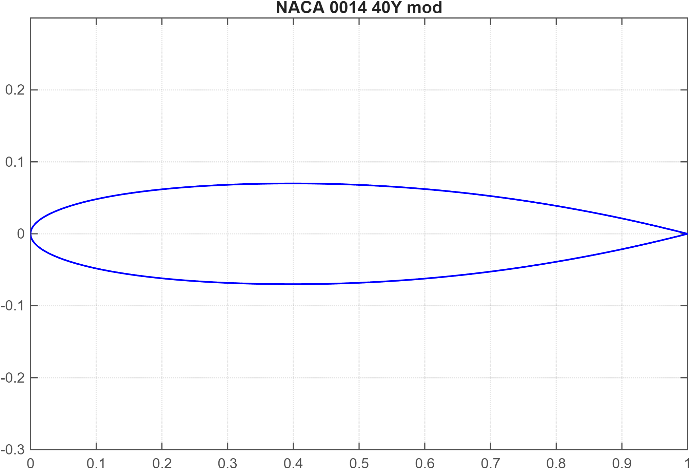
  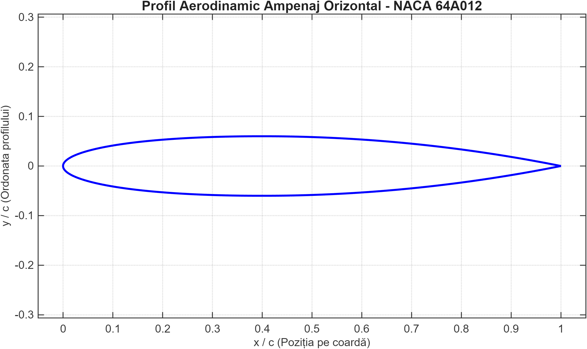
  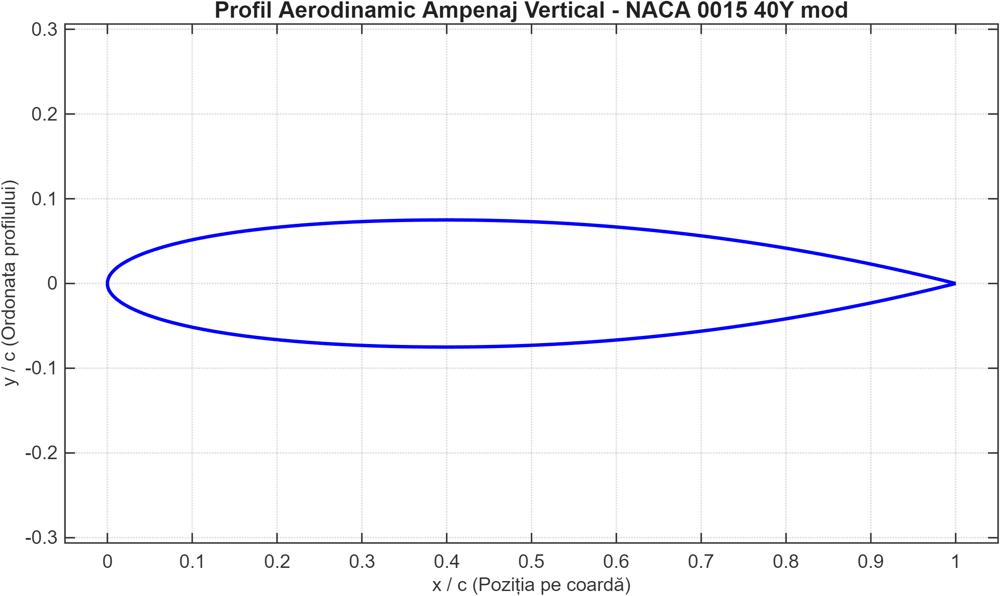

---

## 2. Flight Envelope (V-n Diagram) & Tailplane Maneuver Loads

At structural calculation altitude $H = 1,500\text{ m}$ ($\rho = 1.058\text{ kg/m}^3$, $T = 278.4\text{ K}$), the maneuver and linear progressive gust envelope ($\eta_G = 0.796$, mass parameter $\mu_G = 50.21$) yields the following load factors[span_113](start_span)[span_113](end_span)[span_114](start_span)[span_114](end_span)[span_115](start_span)[span_115](end_span):
* **At Design Maneuvering Speed ($V_B / V_A = 116.92\text{ m/s}$, $w_0 = 20\text{ m/s}$):** $n = 1 \pm 0.45 \implies (+1.45\text{ g}, +0.55\text{ g})$[span_116](start_span)[span_116](end_span)[span_117](start_span)[span_117](end_span).
* **At Design Cruise Speed ($V_C = 224.00\text{ m/s}$, $w_0 = 15\text{ m/s}$):** $n = 1 \pm 1.55 \implies (+2.55\text{ g}, -0.55\text{ g})$[span_118](start_span)[span_118](end_span)[span_119](start_span)[span_119](end_span).
* **At Design Dive Speed ($V_D = 280.00\text{ m/s}$, $w_0 = 7.5\text{ m/s}$):** $n = 1 \pm 0.35 \implies (+1.35\text{ g}, +0.65\text{ g})$[span_120](start_span)[span_120](end_span)[span_121](start_span)[span_121](end_span).

### Longitudinal Maneuver Loads on Horizontal Tailplane (HTP)
1. **Abrupt Elevator Deflection at $V_A = 116.92\text{ m/s}$ ($\Delta\beta_{\max}^+ = +25^\circ$, $\Delta\beta_{\max}^- = -20^\circ$):**[span_122](start_span)[span_122](end_span)
   * Incremental HTP aerodynamic loads: $\Delta P_{ao}^+ = +84,056\text{ N}$ and $\Delta P_{ao}^- = -67,256\text{ N}$[span_123](start_span)[span_123](end_span).
   * Pitching moments ($L_{ao} = 11.5\text{ m}$): $\Delta M_y^+ = -966,642\text{ Nm}$ and $\Delta M_y^- = +773,446\text{ Nm}$[span_124](start_span)[span_124](end_span).
   * Pitching angular accelerations ($J_y = 1.81 \times 10^6\text{ kg}\cdot\text{m}^2$, $r_y = 7.4\text{ m}$): $\varepsilon_y^+ = -0.534\text{ rad/s}^2$, $\varepsilon_y^- = +0.427\text{ rad/s}^2$[span_125](start_span)[span_125](end_span)[span_126](start_span)[span_126](end_span).
   * Local load factor distribution along fuselage station $x' \in [0, 29.61]\text{ m}$ ($x_{\text{CG}} = 13.5\text{ m}$)[span_127](start_span)[span_127](end_span)[span_128](start_span)[span_128](end_span):

$$n^\pm(x') = 1 + \frac{\Delta P_{ao}^\pm}{G} \left[ 1 + \frac{L_{ao}(x' - x_{\text{CG}})}{r_y^2} \right]$$

2. **Checked Elevator Pitch Maneuver ($n_1 = 2.5$):**[span_129](start_span)[span_129](end_span)[span_130](start_span)[span_130](end_span)
   * Pitch angular acceleration and balancing tail load[span_131](start_span)[span_131](end_span):

$$\varepsilon_y = \frac{20}{V_A} n_1 (n_1 - 1.5) = 0.4276\text{ rad/s}^2 \implies \Delta P_{ao} = -\frac{G}{g} \frac{r_y^2}{L_{ao}} \varepsilon_y = -67,423\text{ N}$$

$$n(x') = 1 - \frac{\varepsilon_y}{g} \left[ \frac{r_y^2}{L_{ao}} + (x' - x_{\text{CG}}) \right]$$

### Directional Maneuver Loads on Vertical Tailplane (VTP) & Landing Loads
* **Abrupt Rudder Deflection ($\Delta\beta_{\max}^\pm = \pm 25^\circ$ at $V_A$):** Generates incremental VTP lateral force $\Delta P_{av}^\pm = \pm 55,626\text{ N}$, roll moment $\Delta M_x^+ = -178,004\text{ Nm}$, yaw moment $\Delta M_z^+ = +639,703\text{ Nm}$, roll acceleration $\varepsilon_x^\pm = \mp 0.274\text{ rad/s}^2$ ($r_x = 4.43\text{ m}$), and yaw acceleration $\varepsilon_z^\pm = \pm 0.328\text{ rad/s}^2$ ($r_z = 7.67\text{ m}$)[span_132](start_span)[span_132](end_span)[span_133](start_span)[span_133](end_span).
* **Landing Gear Impact ($n_{at} = 2.667$, lift fraction $L = 0.667$, friction $\mu = 0.33$):**[span_134](start_span)[span_134](end_span)
  * **Two-Point Main Gear Landing:** Vertical reaction $Rz_{tp} = 649,618\text{ N}$, drag reaction $Rx_{tp} = 214,374\text{ N}$, pitch-down angular acceleration $\varepsilon_y = 0.691\text{ rad/s}^2$[span_135](start_span)[span_135](end_span)[span_136](start_span)[span_136](end_span).
  * **Three-Point Landing:** Nose gear vertical reaction $Rz_{tb} = 69,660\text{ N}$ ($Rx_{tb} = 22,969\text{ N}$), main gear vertical reaction $Rz_{tp} = 580,016\text{ N}$ ($Rx_{tp} = 191,405\text{ N}$)[span_137](start_span)[span_137](end_span).

  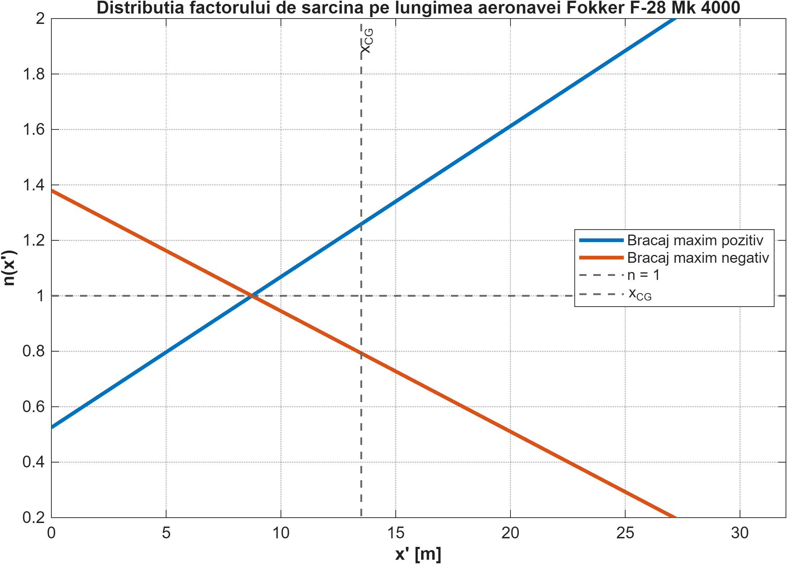
  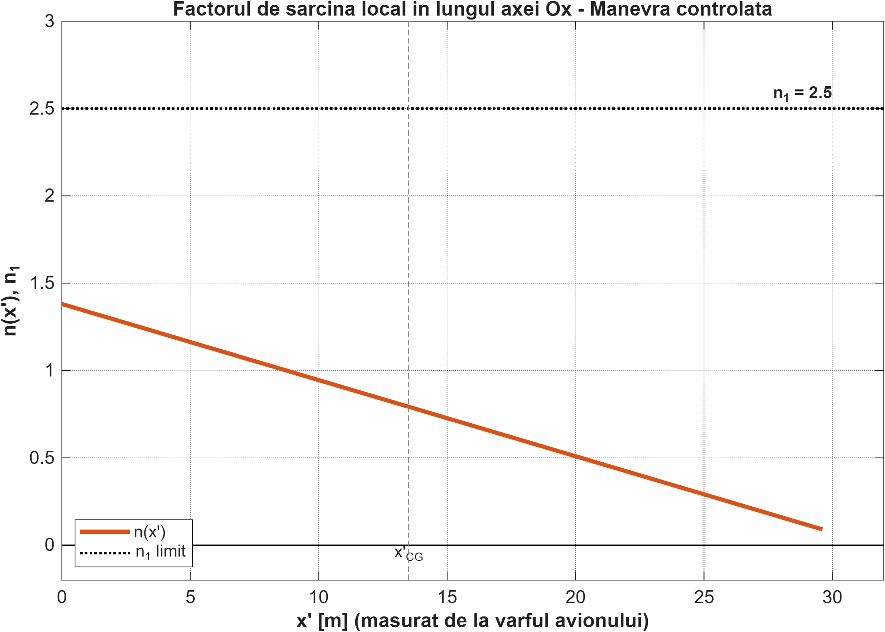
  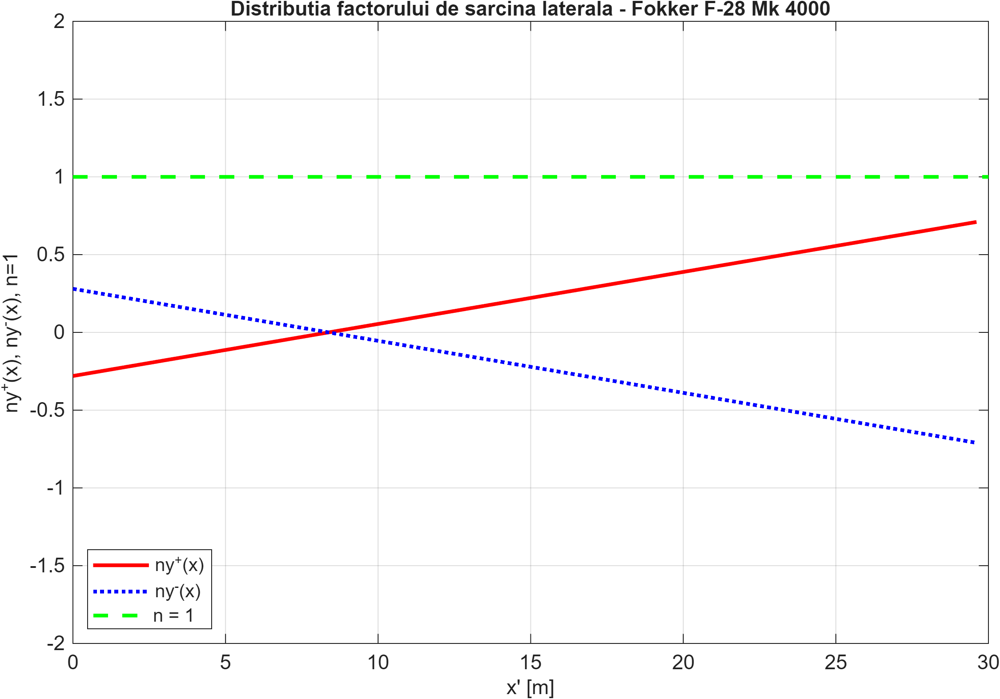

---

## 3. Spanwise Wing Loads & Sectional Internal Efforts ($T_z, M_x, M_t$)

### Diederich Spanwise Aerodynamic & Inertial Load Distribution
Spanwise lift distribution across the semi-span ($b = 12.54\text{ m}$, total wing lift $P_a = 827,650\text{ N}$, wing pitching moment $M_{Fa} = -2,097.31\text{ kNm}$) is resolved via the **Diederich method** ($C_1 = 0.50, C_2 = 0.16, C_3 = 0.38$)[span_138](start_span)[span_138](end_span)[span_139](start_span)[span_139](end_span)[span_140](start_span)[span_140](end_span)[span_141](start_span)[span_141](end_span):

$$L_a(\eta) = C_1 \frac{c(\eta)}{\text{CMG}} + C_2 \frac{4}{\pi}\sqrt{1 - \eta^2} + C_3 f(\eta), \quad p_a(y) = \frac{P_a}{2b} L_a(\eta)$$

Inertial relief from the wing structure ($m_a = 3,600\text{ kg} \implies p_g = 1,118\text{ N/m}$) and integral fuel tanks ($m_c = 8,000\text{ kg} \implies p_{gc} = 6,330.7\text{ N/m}$) counteracts aerodynamic bending[span_142](start_span)[span_142](end_span)[span_143](start_span)[span_143](end_span). Following standard instructional structural sizing methodology, discrete inertial relief from concentrated powerplant and main landing gear masses ($N_M = 27.21\text{ kN}$, $N_{TP} = 42.26\text{ kN}$) is modeled at spanwise station $y_{MT} = 3.20\text{ m}$[span_144](start_span)[span_144](end_span)[span_145](start_span)[span_145](end_span).

  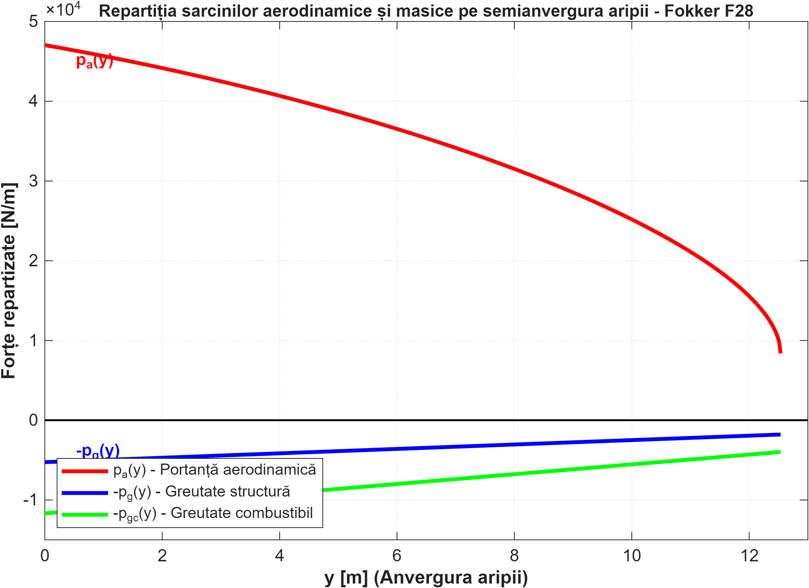

### Piecewise Analytical Integration across 4 Wing Intervals
The semi-span is partitioned into four structural domains[span_146](start_span)[span_146](end_span)[span_147](start_span)[span_147](end_span)[span_148](start_span)[span_148](end_span):
* **Interval 1 ($8.50 \le y \le 12.54\text{ m}$):** Outboard wing tip (aerodynamic lift $p_a(y)$ + structural mass relief $-p_g$)[span_149](start_span)[span_149](end_span).
* **Interval 2 ($3.20 \le y \le 8.50\text{ m}$):** Integral fuel tank bay (adds distributed fuel inertial relief $-p_{gc}$)[span_150](start_span)[span_150](end_span)[span_151](start_span)[span_151](end_span).
* **Interval 3 ($1.65 \le y \le 3.20\text{ m}$):** Inboard of nacelle/landing gear station (incorporates discrete shear step $\Delta T_z = -69.47\text{ kN}$ and concentrated torque step $M_{t,MT} = -9.01\text{ kNm}$)[span_152](start_span)[span_152](end_span)[span_153](start_span)[span_153](end_span).
* **Interval 4 ($0 \le y \le 1.65\text{ m}$):** Wing-fuselage carry-through root section[span_154](start_span)[span_154](end_span).

$$T_z(y) = \int_y^{12.54} q_{\text{net}}(\xi)\,d\xi, \quad M_x(y) = \int_y^{12.54} T_z(\xi)\,d\xi, \quad M_t(y) = \int_y^{12.54} m_t(\xi)\,d\xi$$[span_155](start_span)[span_155](end_span)[span_156](start_span)[span_156](end_span)[span_157](start_span)[span_157](end_span)

*Note on Internal Efforts Consistency:* The values in the table below correspond to limit operating loads at key structural stations under design maneuver conditions ($n = 2.5$), whereas ultimate design loads at the root ($T_{zU} = 430.46\text{ kN}$, $M_{xU} = 2,641.94\text{ kNm}$[span_158](start_span)[span_158](end_span)) incorporate the standard ultimate safety factor $SF = 1.5$[span_159](start_span)[span_159](end_span)[span_160](start_span)[span_160](end_span) for material sizing.

| Spanwise Station $y$ [m] | Structural Location | Shear Force $T_z$ [kN] | Bending Moment $M_x$ [kNm] | Torsion Moment $M_t$ [kNm] |
| :---: | :--- | :---: | :---: | :---: |
| **12.54** | Wing Tip | 0.00 | 0.00 | 0.00 |
| **8.50** | Outboard Fuel Tank Boundary[span_161](start_span)[span_161](end_span) | 92.48[span_162](start_span)[span_162](end_span) | 161.51[span_163](start_span)[span_163](end_span) | 18.89[span_164](start_span)[span_164](end_span) |
| **3.20 (+)** | Outboard of Landing Gear / Nacelle[span_165](start_span)[span_165](end_span) | 243.07[span_166](start_span)[span_166](end_span) | 1,033.39[span_167](start_span)[span_167](end_span) | 183.37[span_168](start_span)[span_168](end_span) |
| **3.20 (-)** | Inboard of Landing Gear / Nacelle[span_169](start_span)[span_169](end_span) | 173.60[span_170](start_span)[span_170](end_span) | 1,033.39[span_171](start_span)[span_171](end_span) | 192.39[span_172](start_span)[span_172](end_span) |
| **1.65** | Wing-Fuselage Root Junction[span_173](start_span)[span_173](end_span) | 223.02[span_174](start_span)[span_174](end_span) | 1,340.61[span_175](start_span)[span_175](end_span) | 210.89[span_176](start_span)[span_176](end_span) |
| **0.00** | Aircraft Centerline (Max Root Load)[span_177](start_span)[span_177](end_span) | **286.97**[span_178](start_span)[span_178](end_span) | **1,761.29**[span_179](start_span)[span_179](end_span) | **231.02**[span_180](start_span)[span_180](end_span) |

  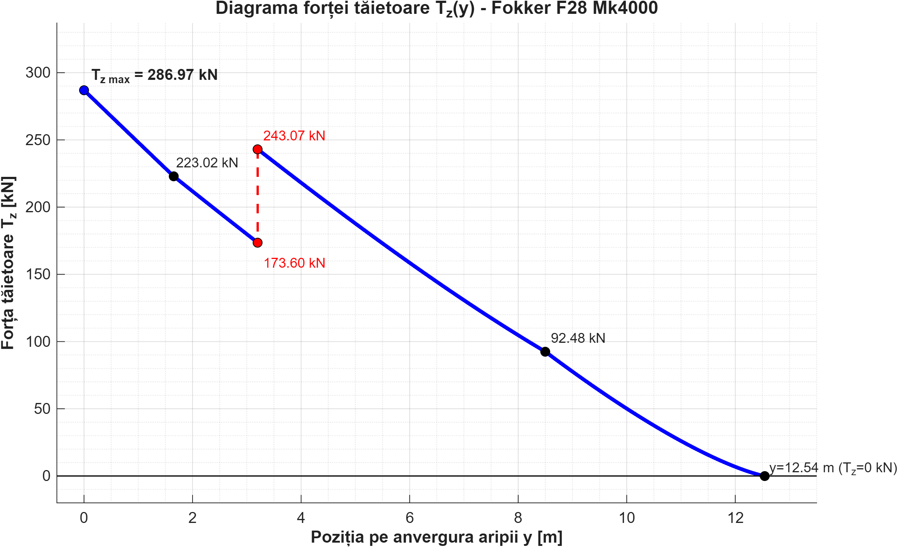
  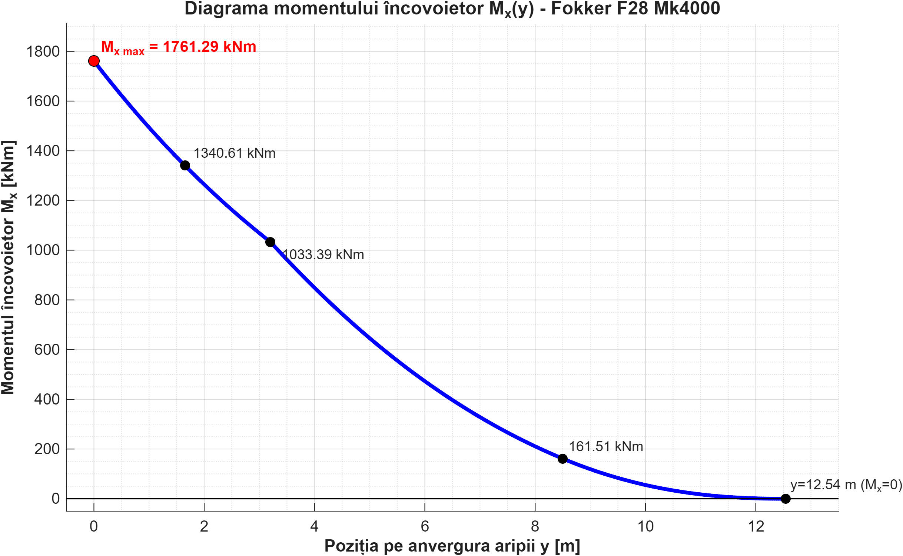

  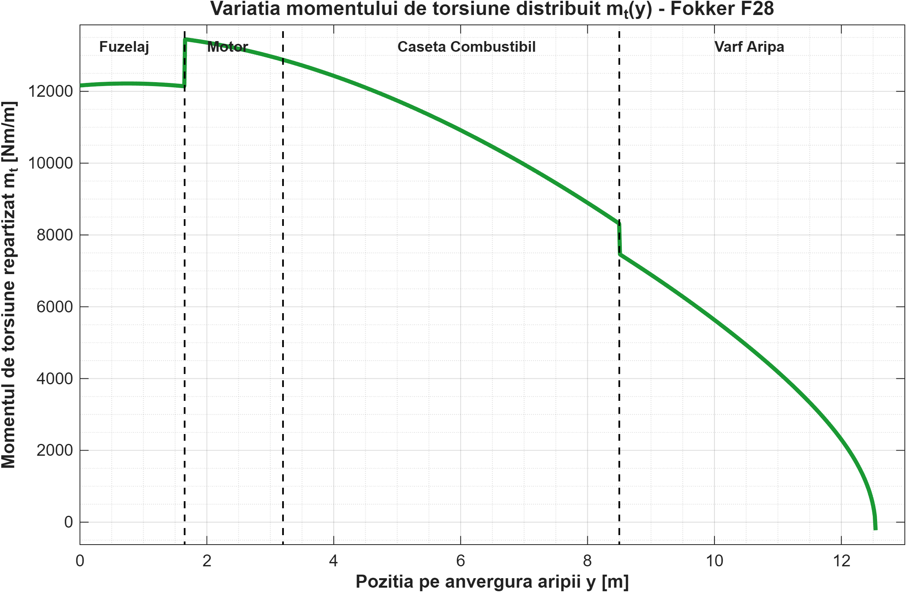
  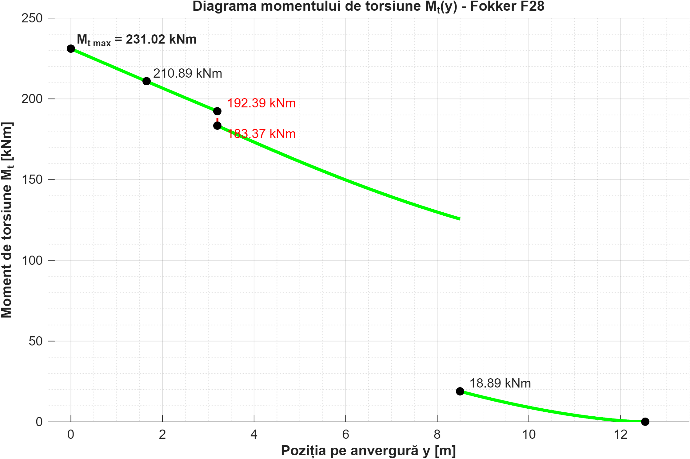

---

## 4. Wing-Box Structural Sizing & Post-Buckling Elastic Stability

The primary wing-box structure is designed using **Al 2024-T3** duralumin ($\sigma_R^+ = 440\text{ MPa}$, $\sigma_{cc} = 315\text{ MPa}$, $\tau_{\text{adm}} = 220\text{ MPa}$, $E = 73\text{ GPa}$, $\nu = 0.3$, $\rho = 2,780\text{ kg/m}^3$)[span_181](start_span)[span_181](end_span) in a two-spar torsion-box layout positioned at $15\%c$ ($h_1 = 0.6075\text{ m}$) and $65\%c$ ($h_2 = 0.5346\text{ m}$)[span_182](start_span)[span_182](end_span), with structural box width $\Delta = 2.25\text{ m}$[span_183](start_span)[span_183](end_span) and enclosed cell area $\Omega = 1.2849\text{ m}^2$[span_184](start_span)[span_184](end_span).

### Root Section Preliminary Sizing ($k = 0.5$ Bending Split, Safety Factor $SF = 1.5$)
* **Ultimate Root Design Loads:** $T_{zU} = 430.46\text{ kN}$, $M_{xU} = 2,641.94\text{ kNm}$, $M_{tU} = 186.44\text{ kNm}$ (corresponding to limit root design torque $M_{tL} = 124.30\text{ kNm}$)[span_185](start_span)[span_185](end_span).
* **Front Spar (Spar 1):** Tension flange area $A_{T1}^+ = 4,408.55\text{ mm}^2$ ($\sigma_1^+ = 293.33\text{ MPa} < 440\text{ MPa}$); Compression flange area $A_{T1}^- = 10,263.28\text{ mm}^2$ ($\sigma_1^- = 126.00\text{ MPa} < 315\text{ MPa}$); Web thickness $\delta_1 = 2.54\text{ mm}$ ($q_{U1}^* = 557.80\text{ kN/m}$)[span_186](start_span)[span_186](end_span)[span_187](start_span)[span_187](end_span).
* **Rear Spar (Spar 2):** Tension flange area $A_{T2}^+ = 3,879.52\text{ mm}^2$ ($\sigma_2^+ = 258.13\text{ MPa} < 440\text{ MPa}$); Compression flange area $A_{T2}^- = 9,031.69\text{ mm}^2$ ($\sigma_2^- = 110.88\text{ MPa} < 315\text{ MPa}$); Web thickness $\delta_2 = 2.19\text{ mm}$ ($q_{U2}^* = 481.33\text{ kN/m}$)[span_188](start_span)[span_188](end_span)[span_189](start_span)[span_189](end_span).
* **Stiffened Upper Skin Panel ($N^- = 4$ stringers, pitch $b_l = 450\text{ mm}$, rib spacing $a = 900\text{ mm}$):**[span_190](start_span)[span_190](end_span)[span_191](start_span)[span_191](end_span)
  * Initial buckling skin thickness $\delta_1 = 4.31\text{ mm}$ with stringer area $A_{\text{lise}}^- = 1,454.26\text{ mm}^2$[span_192](start_span)[span_192](end_span).
  * Adopted working skin thickness $\delta^- = 11.0\text{ mm}$, yielding a Von Kármán effective working panel area $A_{\text{panou}}^- = 26,597.48\text{ mm}^2 \ge 12,239.31\text{ mm}^2$ (Verified)[span_193](start_span)[span_193](end_span)[span_194](start_span)[span_194](end_span).

### Post-Buckling & Elastic Stability Verification
For the upper compression skin panel ($a = 0.90\text{ m}$, $b = 0.45\text{ m}$, $\delta = 11\text{ mm}$, wing-box moment of inertia $I_x = 0.02293\text{ m}^4$)[span_195](start_span)[span_195](end_span)[span_196](start_span)[span_196](end_span):

$$\sigma_{\text{cr}} = \frac{k_\sigma \pi^2 E}{12(1 - \nu^2)} \left(\frac{\delta}{b}\right)^2, \quad \tau_{\text{cr}} = \frac{k_\tau \pi^2 E}{12(1 - \nu^2)} \left(\frac{\delta}{b}\right)^2$$[span_197](start_span)[span_197](end_span)[span_198](start_span)[span_198](end_span)

| Stability Mode | Boundary Condition | Buckling Coeff. | Critical Buckling Stress | Operating Limit Stress | Status |
| :--- | :--- | :---: | :---: | :---: | :---: |
| **Compressive Buckling** | Simply Supported (4 edges)[span_199](start_span)[span_199](end_span) | $k_\sigma = 4.00$[span_200](start_span)[span_200](end_span) | $\sigma_{\text{cr},1} = 157.70\text{ MPa}$[span_201](start_span)[span_201](end_span) | $\sigma_{\text{ef}} = 24.20\text{ MPa}$[span_202](start_span)[span_202](end_span) | **STABLE**[span_203](start_span)[span_203](end_span) |
| **Compressive Buckling** | Clamped Loaded Edges[span_204](start_span)[span_204](end_span) | $k_\sigma = 7.00$[span_205](start_span)[span_205](end_span) | $\sigma_{\text{cr},2} = 275.97\text{ MPa}$[span_206](start_span)[span_206](end_span) | $\sigma_{\text{ef}} = 24.20\text{ MPa}$[span_207](start_span)[span_207](end_span) | **STABLE** |
| **Shear Buckling** | Simply Supported (4 edges)[span_208](start_span)[span_208](end_span) | $k_{\tau,1} = 6.35$[span_209](start_span)[span_209](end_span) | $\tau_{\text{cr},1} = 250.34\text{ MPa}$[span_210](start_span)[span_210](end_span) | $\tau_{SL} = 4.40\text{ MPa}$[span_211](start_span)[span_211](end_span) | **STABLE**[span_212](start_span)[span_212](end_span) |
| **Shear Buckling** | Clamped Spar Flanges[span_213](start_span)[span_213](end_span) | $k_{\tau,2} = 9.98$[span_214](start_span)[span_214](end_span) | $\tau_{\text{cr},2} = 393.45\text{ MPa}$[span_215](start_span)[span_215](end_span) | $\tau_{SL} = 4.40\text{ MPa}$[span_216](start_span)[span_216](end_span) | **STABLE** |

---

## How to Run

1. Clone the repository:
   * `git clone https://github.com/yrydavid/Fokker-F28-Structural-Loads-WingBox-Analysis.git`
   * `cd Fokker-F28-Structural-Loads-WingBox-Analysis`
2. Open MATLAB in the repository root directory and run any of the 11 scripts to generate the aerodynamic profiles, fuselage maneuver load distributions, or spanwise wing effort diagrams[span_217](start_span)[span_217](end_span)[span_218](start_span)[span_218](end_span)[span_219](start_span)[span_219](end_span)[span_220](start_span)[span_220](end_span)[span_221](start_span)[span_221](end_span)[span_222](start_span)[span_222](end_span)[span_223](start_span)[span_223](end_span)[span_224](start_span)[span_224](end_span)[span_225](start_span)[span_225](end_span)[span_226](start_span)[span_226](end_span)[span_227](start_span)[span_227](end_span).

---

## Author & Contact

**David Irinei**  
Aerospace Engineering Student – National University of Science and Technology POLITEHNICA Bucharest  
Specialization: Aerospace Construction (*Construcții Aerospațiale*)  
Email: [yrydavid@gmail.com](mailto:yrydavid@gmail.com)
